> 2026-10-22 アカウント運用変更：初期接続・初期管理者は開発担当、日常のGoogleアカウント登録・停止・削除・生徒紐付け・家庭URL再発行は管理者画面で行う。[現行仕様](../ACCOUNT_MANAGEMENT.md)を優先。Calendar未追加・本番未開始。

# 画面キャプチャ付き受入テスト結果仕様書（DOC-ATR-001）

> 2026-10-22 最新：管理者2名のGoogleログイン・台帳表示・再読込・ログアウト確認済み。管理者によるアカウント管理を検証サイトへ反映し、架空登録の作成・停止・有効化・URL再発行・削除を実測。旧キー認証は停止。[Step11](../progress/2026-10-22-step-11.md)を優先。家庭別・第三者30件・AT24〜30は未合格。Calendar未追加・本番未開始。

> 2026-10-22 追記：認証方式は顧客確認待ち。第三者が全30件を実施し全件合格することを本番前条件に追加（第三者0/30）。公開先読込障害の追跡・異常応答ガード配信・PPT v15確認は[Step10](../progress/2026-10-22-step-10.md)を参照。Calendar未追加・本番未開始。

> 2026-10-21 設定進捗：FirebaseのWebアプリ登録・Google認証有効化・検証ドメイン保存と、検証GASの対象台帳操作・外部通信の承認を確認しました。本人UID登録と実Googleログイン、新GASのデプロイ・新サイトへの切替は未完了です。Calendarは未追加。本番運用は開始していません。[Step 08](../progress/2026-10-21-step-08.md)を参照。

> 2026-10-21仕様追補（未公開）: [開発者セットアップ・Google本人確認](../DEVELOPER_SETUP_OVERVIEW.md)を追加します。旧キー方式の結果は過去版の記録です。新方式のローカル試験と実Google・公開確認を分け、AT-24〜30の7件は未合格を維持します。

> 現行仕様（2026-10-20追加）: [管理者・家庭別ポータル／個別URL・QR](../PORTAL_SEPARATION.md)と[Step 06](../progress/2026-10-20-step-06.md)を優先してください。以下の旧実行結果は当時の版の記録です。現在はAT-23 PASS、AT-24〜30の7件未合格。新仕様の補足試験はGAS42件・フロント契約9件・実API読み取り11件を別集計し、元の30受入項目へ加算しません。

> 2026-10-20 Step 05 最新補遺: **AT-23 PASS**。Web登録1行・再読込・不足3シート生成・既存82セル保全を実測。残るAT-24〜30は7件未合格。次はAT-24の検証先と権限確認。過去runの判定とJSONは変更していない。[実測と証跡](../progress/2026-10-20-step-05.md)。

文書版: 2026-10-20 / 不合格6件修正・再試験版。実環境の受入済み・リリース済みを意味しない。

判定: **リリース不可（未受入）**。不合格・未実施を残したままリリースしない。

| 総数 | PASS | FAIL | BLOCKED | NOT RUN |
| --- | --- | --- | --- | --- |
| 30 | 22 | 0 | 8 | 0 |

実行ID: 2026-10-19T16-59-40-731Z。対象: http://127.0.0.1:4179。方式: Built dist UI + TypeScript-transpiled source API assertions / fresh headless shell profile / demo LocalStorage; external requests blocked。タイムゾーン: Asia/Tokyo。基準コミット: 2fa6127715017d52ae0c9bd80be39c4db90a47c3（未コミットのテスト・仕様書を含むためsourceHashesも参照）。

[生データ・assert結果・ソース/画像ハッシュ](runs/2026-10-19T16-59-40-731Z/results.json) / [サーバーログ](runs/2026-10-19T16-59-40-731Z/server.log)。

旧docs/evidenceおよびGoogleDrive_Upload配下の結果は過去の参考資料として保持する。コード表示によるカレンダー検証・assertなしのPASS・同一ブラウザ内の切替は、今回の実Google連携・複数端末の合格として引き継がない。

## AT-01 Google連携先の設定保存: PASS

[BF-01](01_BUSINESS_FLOWS.md#BF-01) / [UC-01](02_USE_CASES.md#UC-01) / [REQ-01](03_REQUIREMENTS.md#REQ-01) / [FS-01](04_FUNCTIONAL_SPEC.md#FS-01) / [TASK-01](05_TASKS.md#TASK-01) / [AT-01](06_ACCEPTANCE_TEST_SPEC.md#AT-01) / [CODE-01](07_TRACEABILITY_MATRIX.md#CODE-01) / [TEST-01](06_ACCEPTANCE_TEST_SPEC.md#TEST-01)

期待: 保存したURLが再読込後も一致。

実測: 仕様の期待結果を自動assertで確認。デモとローカル模擬API（AT-18/19）のみ。実Google連携は未実施。。

開始: 2026-10-19T16:59:41.257Z / 終了: 2026-10-19T16:59:45.234Z。

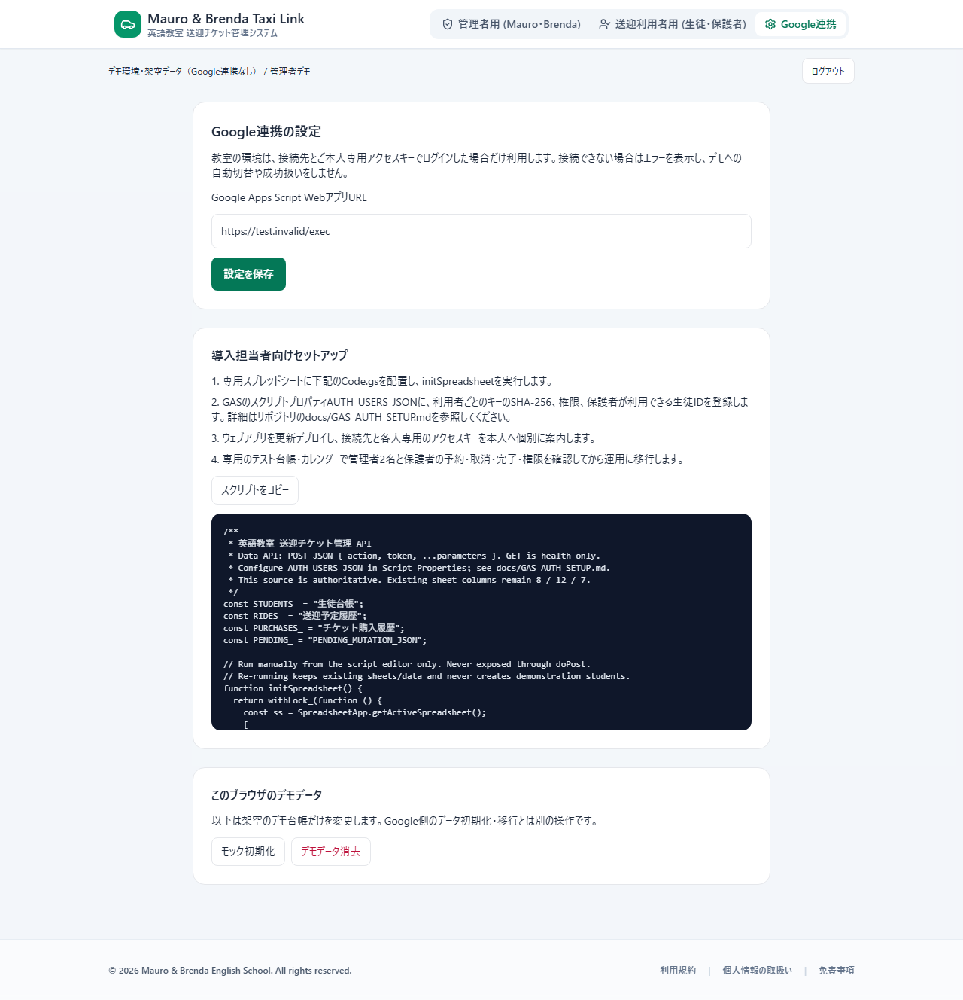

画像SHA-256: ec3751bbaf139de02f2d0ba407a8dd57e4fb7831db9b2f099ba0d35c13d5b082

次の対応: [TASK-01](05_TASKS.md#TASK-01)。

## AT-02 生徒登録: PASS

[BF-02](01_BUSINESS_FLOWS.md#BF-02) / [UC-02](02_USE_CASES.md#UC-02) / [REQ-02](03_REQUIREMENTS.md#REQ-02) / [FS-02](04_FUNCTIONAL_SPEC.md#FS-02) / [TASK-02](05_TASKS.md#TASK-02) / [AT-02](06_ACCEPTANCE_TEST_SPEC.md#AT-02) / [CODE-02](07_TRACEABILITY_MATRIX.md#CODE-02) / [TEST-02](06_ACCEPTANCE_TEST_SPEC.md#TEST-02)

期待: 生徒が1件増え全入力値と初期残高10が保存される。

実測: 仕様の期待結果を自動assertで確認。デモとローカル模擬API（AT-18/19）のみ。実Google連携は未実施。。

開始: 2026-10-19T16:59:45.234Z / 終了: 2026-10-19T16:59:47.962Z。

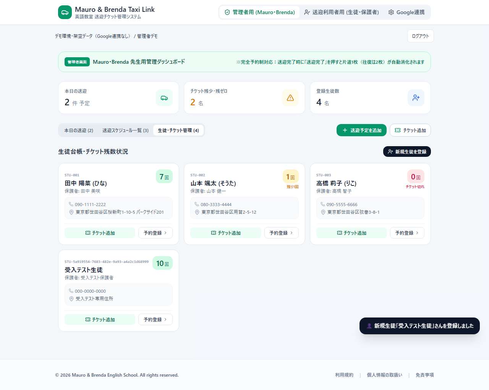

画像SHA-256: 20d50d8d9fa11d589ede2431b6af3cbd7923f273deb956468f526177d6889ee1

次の対応: [TASK-02](05_TASKS.md#TASK-02)。

## AT-03 保護者の残数確認: PASS

[BF-03](01_BUSINESS_FLOWS.md#BF-03) / [UC-03](02_USE_CASES.md#UC-03) / [REQ-03](03_REQUIREMENTS.md#REQ-03) / [FS-03](04_FUNCTIONAL_SPEC.md#FS-03) / [TASK-03](05_TASKS.md#TASK-03) / [AT-03](06_ACCEPTANCE_TEST_SPEC.md#AT-03) / [CODE-03](07_TRACEABILITY_MATRIX.md#CODE-03) / [TEST-03](06_ACCEPTANCE_TEST_SPEC.md#TEST-03)

期待: 氏名と7回分・片道1枚の説明が表示される。

実測: 仕様の期待結果を自動assertで確認。デモとローカル模擬API（AT-18/19）のみ。実Google連携は未実施。。

開始: 2026-10-19T16:59:47.962Z / 終了: 2026-10-19T16:59:50.045Z。

画像SHA-256: 336985bc1dfc709778e298d192e1916e191959c54a208014fb4474c623139478

次の対応: [TASK-03](05_TASKS.md#TASK-03)。

## AT-04 残少・ゼロ案内: PASS

[BF-03](01_BUSINESS_FLOWS.md#BF-03) / [UC-04](02_USE_CASES.md#UC-04) / [REQ-04](03_REQUIREMENTS.md#REQ-04) / [FS-04](04_FUNCTIONAL_SPEC.md#FS-04) / [TASK-04](05_TASKS.md#TASK-04) / [AT-04](06_ACCEPTANCE_TEST_SPEC.md#AT-04) / [CODE-04](07_TRACEABILITY_MATRIX.md#CODE-04) / [TEST-04](06_ACCEPTANCE_TEST_SPEC.md#TEST-04)

期待: 各値でMauro・Brendaへの連絡案内が表示される。

実測: 仕様の期待結果を自動assertで確認。デモとローカル模擬API（AT-18/19）のみ。実Google連携は未実施。。

開始: 2026-10-19T16:59:50.045Z / 終了: 2026-10-19T16:59:55.410Z。

画像SHA-256: 9fdb9d44793499aed9e8e13b9fe8db355842695747d82d6e9c8f27a40a81696e

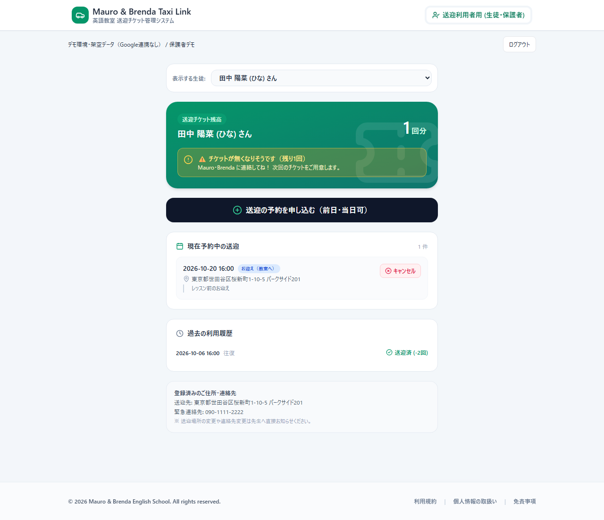

画像SHA-256: 8189b9f575005b15a6c7b347b0396ad10de5a5f9e901fa95c4a78265a99b62b4

画像SHA-256: 19b9a34f23c1caafcfb97966f095673acf2ba4709d79a7f7acec1695e41374f8

画像SHA-256: 9fdb9d44793499aed9e8e13b9fe8db355842695747d82d6e9c8f27a40a81696e

次の対応: [TASK-04](05_TASKS.md#TASK-04)。

## AT-05 チケット追加: PASS

[BF-03](01_BUSINESS_FLOWS.md#BF-03) / [UC-05](02_USE_CASES.md#UC-05) / [REQ-05](03_REQUIREMENTS.md#REQ-05) / [FS-05](04_FUNCTIONAL_SPEC.md#FS-05) / [TASK-05](05_TASKS.md#TASK-05) / [AT-05](06_ACCEPTANCE_TEST_SPEC.md#AT-05) / [CODE-05](07_TRACEABILITY_MATRIX.md#CODE-05) / [TEST-05](06_ACCEPTANCE_TEST_SPEC.md#TEST-05)

期待: 残高17、履歴1件増、枚数10・金額・備考一致。

実測: 仕様の期待結果を自動assertで確認。デモとローカル模擬API（AT-18/19）のみ。実Google連携は未実施。。

開始: 2026-10-19T16:59:55.410Z / 終了: 2026-10-19T16:59:58.209Z。

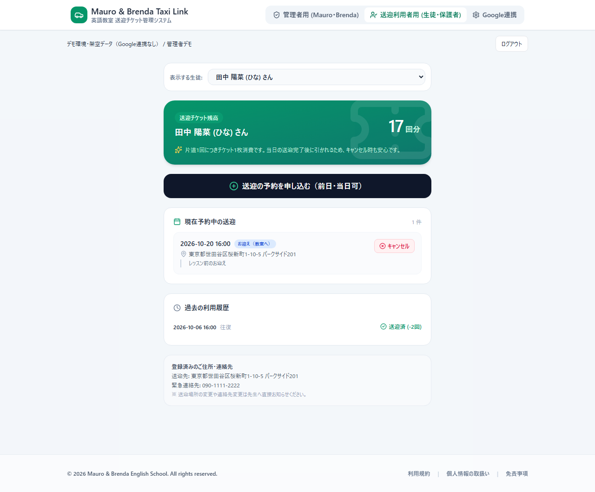

画像SHA-256: eeae6d1c0ec9653a5c6e33a0dbfa211dd68a437978b03019fb81cac918d812c8

次の対応: [TASK-05](05_TASKS.md#TASK-05)。

## AT-06 保護者のお迎え予約: PASS

[BF-04](01_BUSINESS_FLOWS.md#BF-04) / [UC-06](02_USE_CASES.md#UC-06) / [REQ-06](03_REQUIREMENTS.md#REQ-06) / [FS-06](04_FUNCTIONAL_SPEC.md#FS-06) / [TASK-06](05_TASKS.md#TASK-06) / [AT-06](06_ACCEPTANCE_TEST_SPEC.md#AT-06) / [CODE-06](07_TRACEABILITY_MATRIX.md#CODE-06) / [TEST-06](06_ACCEPTANCE_TEST_SPEC.md#TEST-06)

期待: 新規予約1件、scheduled、parent、残高7のまま。

実測: 仕様の期待結果を自動assertで確認。デモとローカル模擬API（AT-18/19）のみ。実Google連携は未実施。。

開始: 2026-10-19T16:59:58.209Z / 終了: 2026-10-19T17:00:00.679Z。

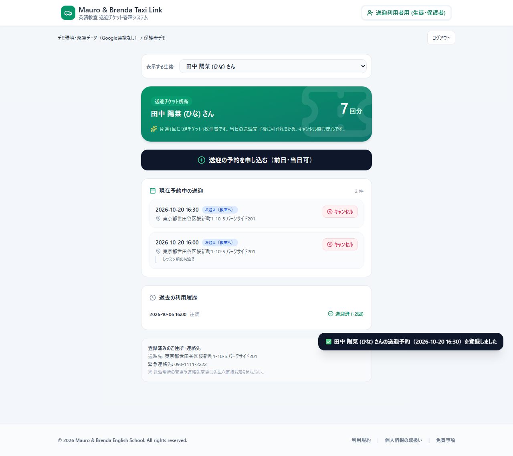

画像SHA-256: aa1fe5ae893784058702d5045b2fa0b9edb4ddcfb052b7c6634abf1b8a8018dc

次の対応: [TASK-06](05_TASKS.md#TASK-06)。

## AT-07 送り予約: PASS

[BF-04](01_BUSINESS_FLOWS.md#BF-04) / [UC-07](02_USE_CASES.md#UC-07) / [REQ-07](03_REQUIREMENTS.md#REQ-07) / [FS-07](04_FUNCTIONAL_SPEC.md#FS-07) / [TASK-07](05_TASKS.md#TASK-07) / [AT-07](06_ACCEPTANCE_TEST_SPEC.md#AT-07) / [CODE-07](07_TRACEABILITY_MATRIX.md#CODE-07) / [TEST-07](06_ACCEPTANCE_TEST_SPEC.md#TEST-07)

期待: dropoffの予約が1件増え、残高7のまま。

実測: 仕様の期待結果を自動assertで確認。デモとローカル模擬API（AT-18/19）のみ。実Google連携は未実施。。

開始: 2026-10-19T17:00:00.680Z / 終了: 2026-10-19T17:00:03.419Z。

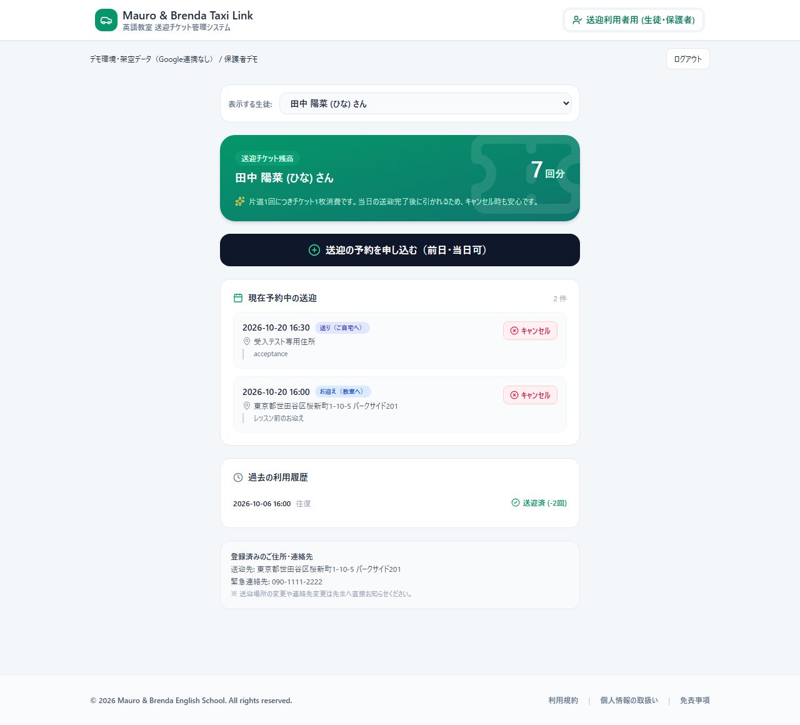

画像SHA-256: efa7b813e186d4d470c920d1af487b5eb11817453dfdbe4561ee41ea021e3357

次の対応: [TASK-07](05_TASKS.md#TASK-07)。

## AT-08 往復予約: PASS

[BF-04](01_BUSINESS_FLOWS.md#BF-04) / [UC-08](02_USE_CASES.md#UC-08) / [REQ-08](03_REQUIREMENTS.md#REQ-08) / [FS-08](04_FUNCTIONAL_SPEC.md#FS-08) / [TASK-08](05_TASKS.md#TASK-08) / [AT-08](06_ACCEPTANCE_TEST_SPEC.md#AT-08) / [CODE-08](07_TRACEABILITY_MATRIX.md#CODE-08) / [TEST-08](06_ACCEPTANCE_TEST_SPEC.md#TEST-08)

期待: roundtripの予約が1件増え、予約時残高7のまま。

実測: 仕様の期待結果を自動assertで確認。デモとローカル模擬API（AT-18/19）のみ。実Google連携は未実施。。

開始: 2026-10-19T17:00:03.419Z / 終了: 2026-10-19T17:00:06.786Z。

画像SHA-256: b5862417ed3e0f9361e70a0b798f53b30529a3d5a34d851cd5de58f44c82efcd

次の対応: [TASK-08](05_TASKS.md#TASK-08)。

## AT-09 管理者の代理予約: PASS

[BF-04](01_BUSINESS_FLOWS.md#BF-04) / [UC-09](02_USE_CASES.md#UC-09) / [REQ-09](03_REQUIREMENTS.md#REQ-09) / [FS-09](04_FUNCTIONAL_SPEC.md#FS-09) / [TASK-09](05_TASKS.md#TASK-09) / [AT-09](06_ACCEPTANCE_TEST_SPEC.md#AT-09) / [CODE-09](07_TRACEABILITY_MATRIX.md#CODE-09) / [TEST-09](06_ACCEPTANCE_TEST_SPEC.md#TEST-09)

期待: 新規予約1件、reservedBy=teacher。

実測: 仕様の期待結果を自動assertで確認。デモとローカル模擬API（AT-18/19）のみ。実Google連携は未実施。。

開始: 2026-10-19T17:00:06.786Z / 終了: 2026-10-19T17:00:08.915Z。

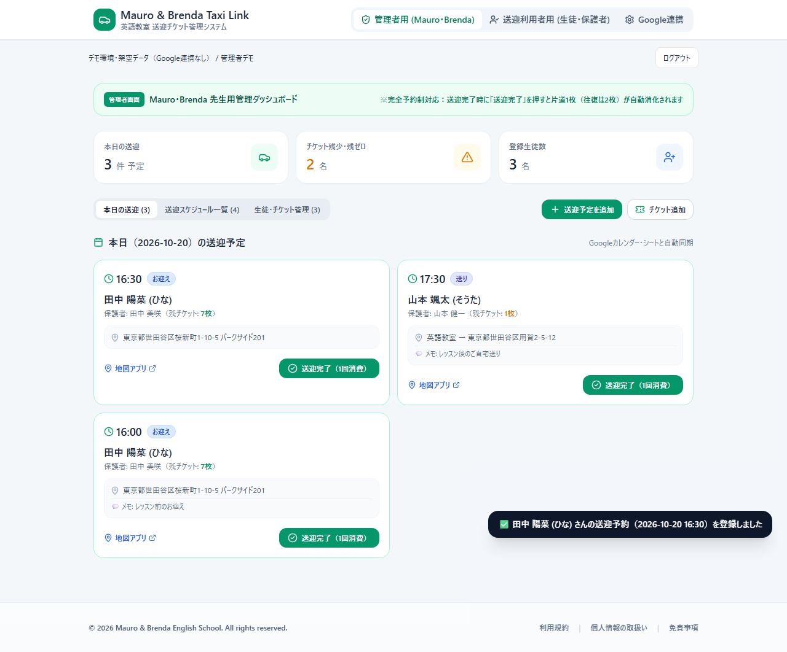

画像SHA-256: 84122712d50d6803baa933e7379cf134b0726414a17ddfb9db8d24c0d4c0190a

次の対応: [TASK-09](05_TASKS.md#TASK-09)。

## AT-10 保護者の予約取消: PASS

[BF-05](01_BUSINESS_FLOWS.md#BF-05) / [UC-10](02_USE_CASES.md#UC-10) / [REQ-10](03_REQUIREMENTS.md#REQ-10) / [FS-10](04_FUNCTIONAL_SPEC.md#FS-10) / [TASK-10](05_TASKS.md#TASK-10) / [AT-10](06_ACCEPTANCE_TEST_SPEC.md#AT-10) / [CODE-10](07_TRACEABILITY_MATRIX.md#CODE-10) / [TEST-10](06_ACCEPTANCE_TEST_SPEC.md#TEST-10)

期待: 対象IDがcancelled、残高7のまま。

実測: 仕様の期待結果を自動assertで確認。デモとローカル模擬API（AT-18/19）のみ。実Google連携は未実施。。

開始: 2026-10-19T17:00:08.915Z / 終了: 2026-10-19T17:00:11.415Z。

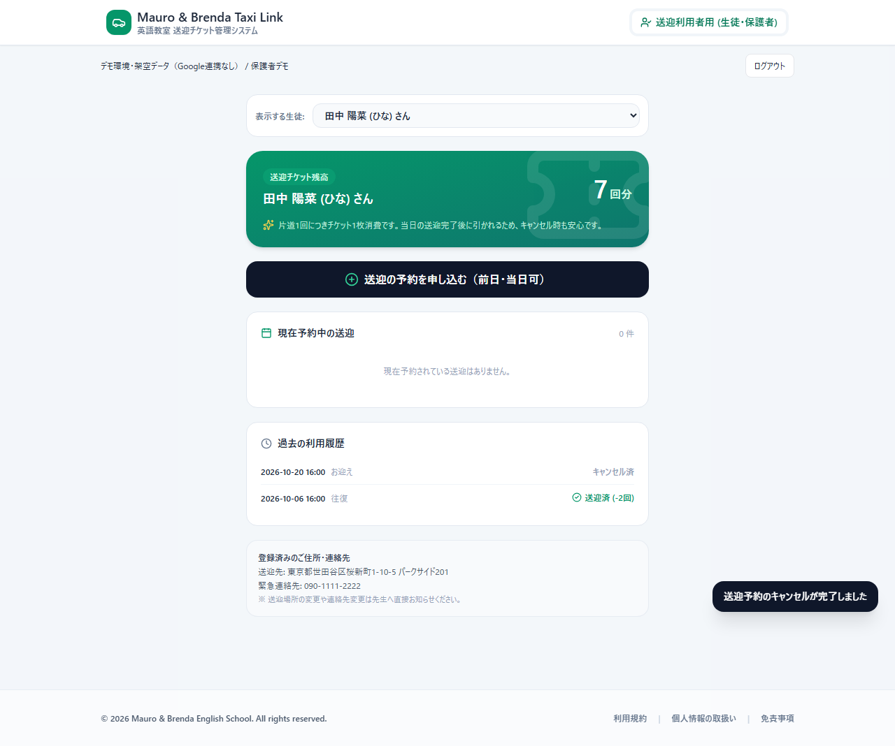

画像SHA-256: 92fcc853e55ca1e3e75dee27d189c3ad8fb61951fa05ad5bc71b92bb7a339931

次の対応: [TASK-10](05_TASKS.md#TASK-10)。

## AT-11 管理者の予約取消: PASS

[BF-05](01_BUSINESS_FLOWS.md#BF-05) / [UC-11](02_USE_CASES.md#UC-11) / [REQ-11](03_REQUIREMENTS.md#REQ-11) / [FS-11](04_FUNCTIONAL_SPEC.md#FS-11) / [TASK-11](05_TASKS.md#TASK-11) / [AT-11](06_ACCEPTANCE_TEST_SPEC.md#AT-11) / [CODE-11](07_TRACEABILITY_MATRIX.md#CODE-11) / [TEST-11](06_ACCEPTANCE_TEST_SPEC.md#TEST-11)

期待: 対象IDがcancelled、残数不変。

実測: 仕様の期待結果を自動assertで確認。デモとローカル模擬API（AT-18/19）のみ。実Google連携は未実施。。

開始: 2026-10-19T17:00:11.415Z / 終了: 2026-10-19T17:00:14.806Z。

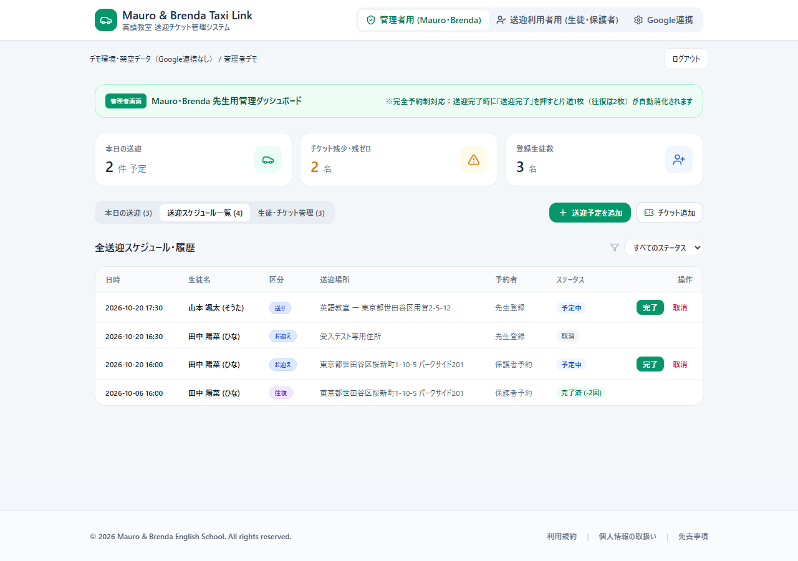

画像SHA-256: 5453d61bc501e51c448ccc9b031eb8f7796b7ede642e0b28986f6daadd387592

次の対応: [TASK-11](05_TASKS.md#TASK-11)。

## AT-12 当日一覧・地図リンク: PASS

[BF-06](01_BUSINESS_FLOWS.md#BF-06) / [UC-12](02_USE_CASES.md#UC-12) / [REQ-12](03_REQUIREMENTS.md#REQ-12) / [FS-12](04_FUNCTIONAL_SPEC.md#FS-12) / [TASK-12](05_TASKS.md#TASK-12) / [AT-12](06_ACCEPTANCE_TEST_SPEC.md#AT-12) / [CODE-12](07_TRACEABILITY_MATRIX.md#CODE-12) / [TEST-12](06_ACCEPTANCE_TEST_SPEC.md#TEST-12)

期待: 当日予約とGoogle Maps検索URLが表示される（地図先の動作は対象外）。

実測: 仕様の期待結果を自動assertで確認。デモとローカル模擬API（AT-18/19）のみ。実Google連携は未実施。。

開始: 2026-10-19T17:00:14.806Z / 終了: 2026-10-19T17:00:16.887Z。

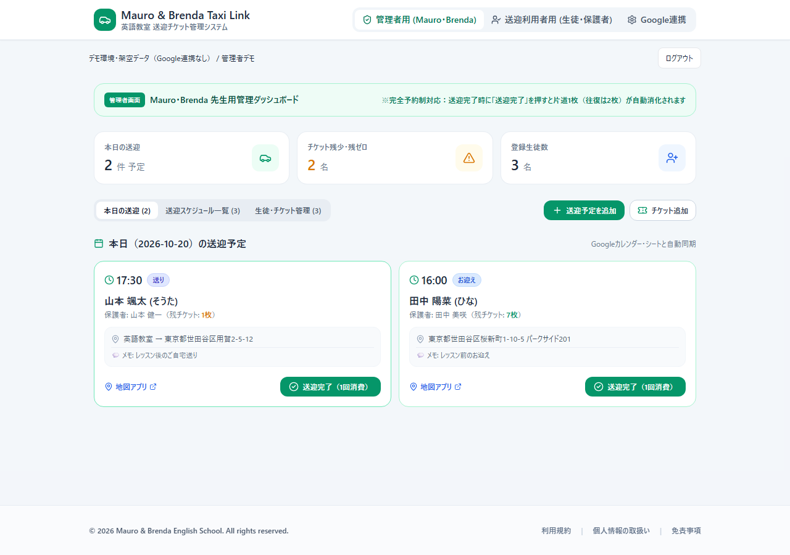

画像SHA-256: 1c204e74b68ad8607da6fbadef908e5b0be40324bec705e768ba023ca2348fcd

次の対応: [TASK-12](05_TASKS.md#TASK-12)。

## AT-13 片道完了: PASS

[BF-06](01_BUSINESS_FLOWS.md#BF-06) / [UC-13](02_USE_CASES.md#UC-13) / [REQ-13](03_REQUIREMENTS.md#REQ-13) / [FS-13](04_FUNCTIONAL_SPEC.md#FS-13) / [TASK-13](05_TASKS.md#TASK-13) / [AT-13](06_ACCEPTANCE_TEST_SPEC.md#AT-13) / [CODE-13](07_TRACEABILITY_MATRIX.md#CODE-13) / [TEST-13](06_ACCEPTANCE_TEST_SPEC.md#TEST-13)

期待: completed・完了日時あり・残高6。

実測: 仕様の期待結果を自動assertで確認。デモとローカル模擬API（AT-18/19）のみ。実Google連携は未実施。。

開始: 2026-10-19T17:00:16.887Z / 終了: 2026-10-19T17:00:20.315Z。

画像SHA-256: 4701ae46535c4e6631f71e02474963c6ccaedb3c79c929f48a015a07978e2caa

次の対応: [TASK-13](05_TASKS.md#TASK-13)。

## AT-14 往復完了: PASS

[BF-06](01_BUSINESS_FLOWS.md#BF-06) / [UC-14](02_USE_CASES.md#UC-14) / [REQ-14](03_REQUIREMENTS.md#REQ-14) / [FS-14](04_FUNCTIONAL_SPEC.md#FS-14) / [TASK-14](05_TASKS.md#TASK-14) / [AT-14](06_ACCEPTANCE_TEST_SPEC.md#AT-14) / [CODE-14](07_TRACEABILITY_MATRIX.md#CODE-14) / [TEST-14](06_ACCEPTANCE_TEST_SPEC.md#TEST-14)

期待: completed・残高5・消費2。

実測: 仕様の期待結果を自動assertで確認。デモとローカル模擬API（AT-18/19）のみ。実Google連携は未実施。。

開始: 2026-10-19T17:00:20.315Z / 終了: 2026-10-19T17:00:23.716Z。

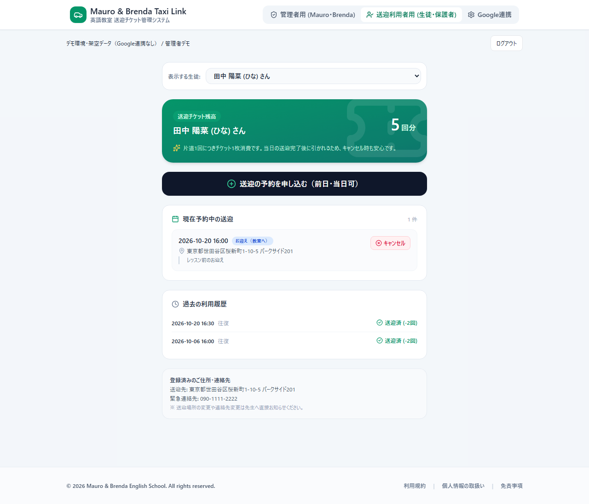

画像SHA-256: f71384abe4ce1953719d0033becbd613078a99030540f6ca90c4c3712cf3d7c3

次の対応: [TASK-14](05_TASKS.md#TASK-14)。

## AT-15 完了の二重処理防止: PASS

[BF-06](01_BUSINESS_FLOWS.md#BF-06) / [UC-15](02_USE_CASES.md#UC-15) / [REQ-15](03_REQUIREMENTS.md#REQ-15) / [FS-15](04_FUNCTIONAL_SPEC.md#FS-15) / [TASK-15](05_TASKS.md#TASK-15) / [AT-15](06_ACCEPTANCE_TEST_SPEC.md#AT-15) / [CODE-15](07_TRACEABILITY_MATRIX.md#CODE-15) / [TEST-15](06_ACCEPTANCE_TEST_SPEC.md#TEST-15)

期待: 最終残高6、completedを保持、再処理の消費枚数0。

実測: 仕様の期待結果を自動assertで確認。デモとローカル模擬API（AT-18/19）のみ。実Google連携は未実施。。

開始: 2026-10-19T17:00:23.716Z / 終了: 2026-10-19T17:00:27.116Z。

画像SHA-256: 4701ae46535c4e6631f71e02474963c6ccaedb3c79c929f48a015a07978e2caa

次の対応: [TASK-15](05_TASKS.md#TASK-15)。

## AT-16 取消済みの完了拒否: PASS

[BF-06](01_BUSINESS_FLOWS.md#BF-06) / [UC-16](02_USE_CASES.md#UC-16) / [REQ-16](03_REQUIREMENTS.md#REQ-16) / [FS-16](04_FUNCTIONAL_SPEC.md#FS-16) / [TASK-16](05_TASKS.md#TASK-16) / [AT-16](06_ACCEPTANCE_TEST_SPEC.md#AT-16) / [CODE-16](07_TRACEABILITY_MATRIX.md#CODE-16) / [TEST-16](06_ACCEPTANCE_TEST_SPEC.md#TEST-16)

期待: cancelledを保持し残高7のまま。

実測: 仕様の期待結果を自動assertで確認。デモとローカル模擬API（AT-18/19）のみ。実Google連携は未実施。。

開始: 2026-10-19T17:00:27.117Z / 終了: 2026-10-19T17:00:30.502Z。

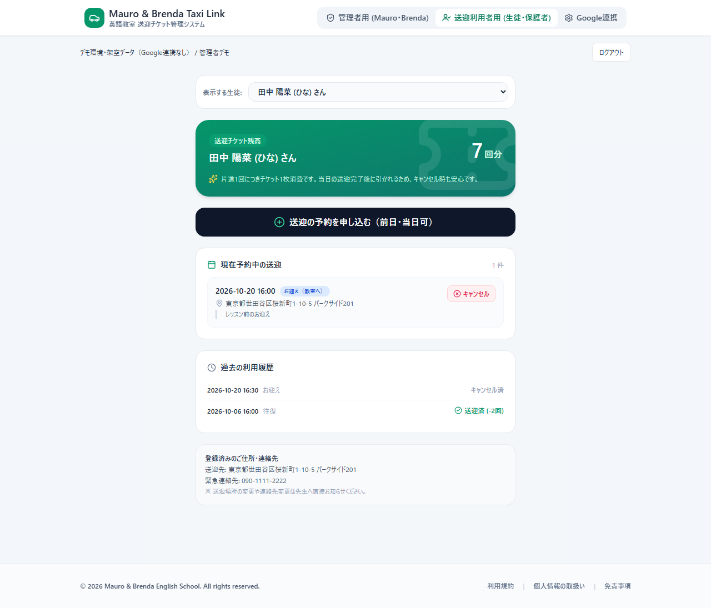

画像SHA-256: eb1bb970571635308d0dfdab87fa5bfd5dca93de4a18ed2768bcaddd296cabce

次の対応: [TASK-16](05_TASKS.md#TASK-16)。

## AT-17 不正なチケット追加拒否: PASS

[BF-03](01_BUSINESS_FLOWS.md#BF-03) / [UC-17](02_USE_CASES.md#UC-17) / [REQ-17](03_REQUIREMENTS.md#REQ-17) / [FS-17](04_FUNCTIONAL_SPEC.md#FS-17) / [TASK-17](05_TASKS.md#TASK-17) / [AT-17](06_ACCEPTANCE_TEST_SPEC.md#AT-17) / [CODE-17](07_TRACEABILITY_MATRIX.md#CODE-17) / [TEST-17](06_ACCEPTANCE_TEST_SPEC.md#TEST-17)

期待: 全要求が拒否され残高7・購入履歴が不変。

実測: 仕様の期待結果を自動assertで確認。デモとローカル模擬API（AT-18/19）のみ。実Google連携は未実施。。

開始: 2026-10-19T17:00:30.502Z / 終了: 2026-10-19T17:00:33.917Z。

画像SHA-256: 63f291859a98224318cb35a39055adeeb63e2fd717cf6d5e801771465c7621be

次の対応: [TASK-17](05_TASKS.md#TASK-17)。

## AT-18 通信障害時に成功扱いしない: PASS

[BF-07](01_BUSINESS_FLOWS.md#BF-07) / [UC-18](02_USE_CASES.md#UC-18) / [REQ-18](03_REQUIREMENTS.md#REQ-18) / [FS-18](04_FUNCTIONAL_SPEC.md#FS-18) / [TASK-18](05_TASKS.md#TASK-18) / [AT-18](06_ACCEPTANCE_TEST_SPEC.md#AT-18) / [CODE-18](07_TRACEABILITY_MATRIX.md#CODE-18) / [TEST-18](06_ACCEPTANCE_TEST_SPEC.md#TEST-18)

期待: すべて拒否、ローカル台帳不変、同一内容再試行の予約ID不変、UIにエラー表示してフォーム維持。

実測: 仕様の期待結果を自動assertで確認。デモとローカル模擬API（AT-18/19）のみ。実Google連携は未実施。。

開始: 2026-10-19T17:00:33.917Z / 終了: 2026-10-19T17:00:36.708Z。

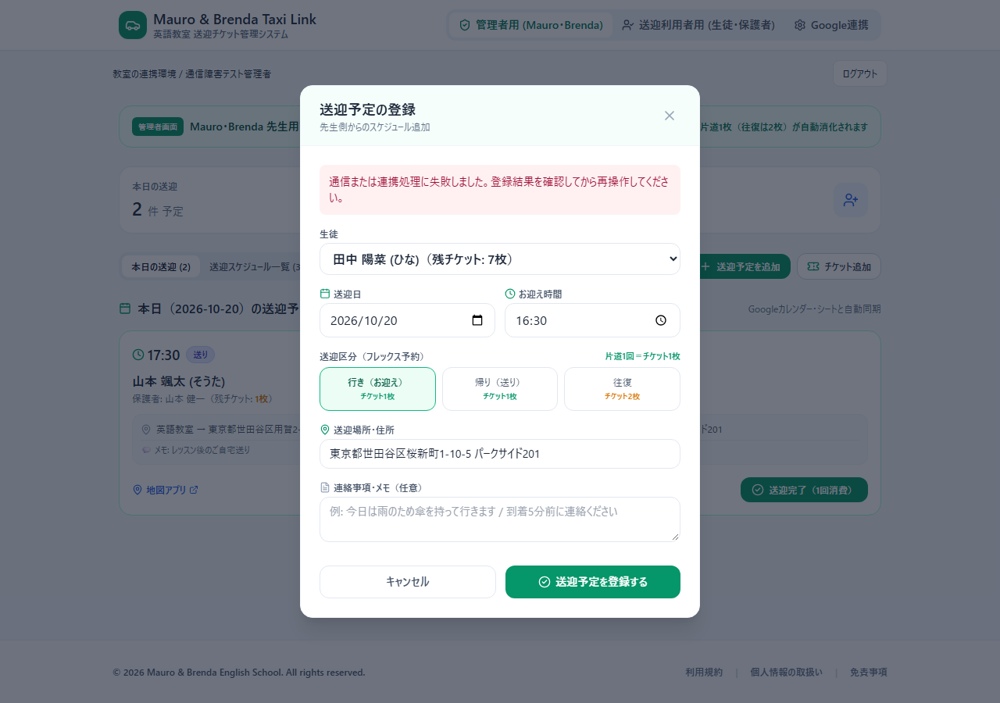

画像SHA-256: e0cfd0abcf05916c63bbe4528fdc35235111622932f9a6412c8f114690aa36d0

次の対応: [TASK-18](05_TASKS.md#TASK-18)。

## AT-19 未認証の管理操作を拒否: PASS

[BF-07](01_BUSINESS_FLOWS.md#BF-07) / [UC-19](02_USE_CASES.md#UC-19) / [REQ-19](03_REQUIREMENTS.md#REQ-19) / [FS-19](04_FUNCTIONAL_SPEC.md#FS-19) / [TASK-19](05_TASKS.md#TASK-19) / [AT-19](06_ACCEPTANCE_TEST_SPEC.md#AT-19) / [CODE-19](07_TRACEABILITY_MATRIX.md#CODE-19) / [TEST-19](06_ACCEPTANCE_TEST_SPEC.md#TEST-19)

期待: 認証前はログイン画面のみ・台帳未生成。キー失効応答後はセッションと画面の個人情報を消しログイン画面に戻る。

実測: 仕様の期待結果を自動assertで確認。デモとローカル模擬API（AT-18/19）のみ。実Google連携は未実施。。

開始: 2026-10-19T17:00:36.708Z / 終了: 2026-10-19T17:00:39.061Z。

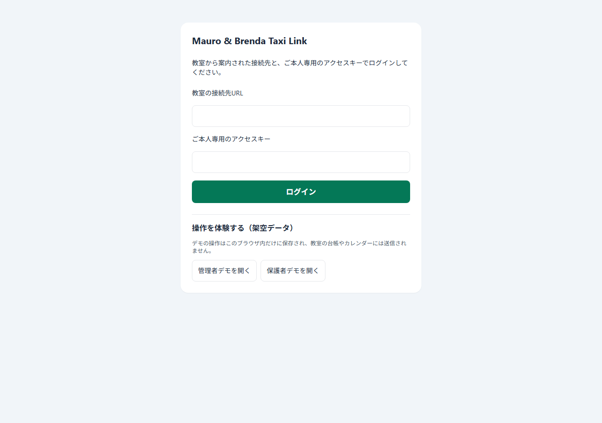

画像SHA-256: f775f9d1b4d9603d157b011f4efb464ac6960c0273b301403284503e9faf0f3a

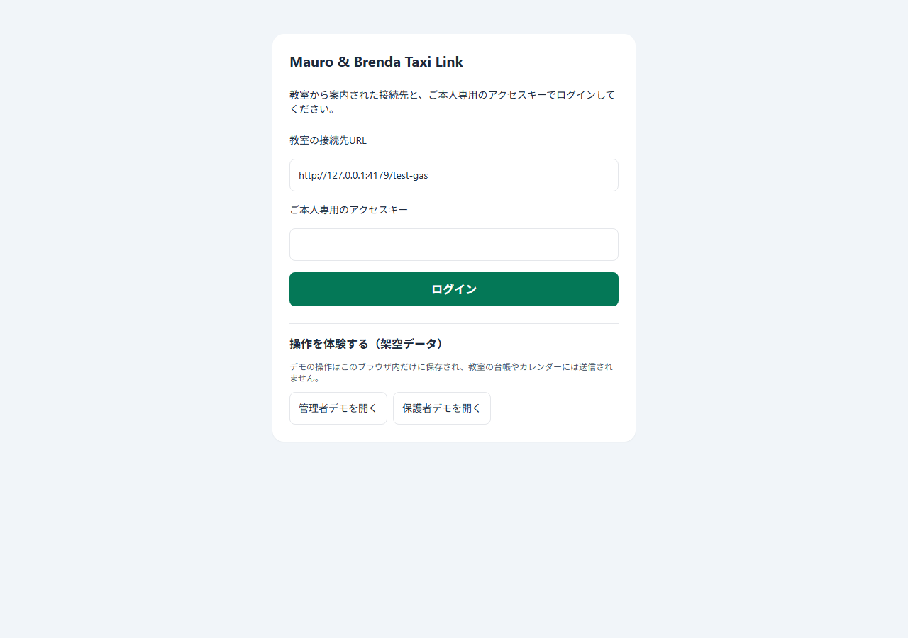

画像SHA-256: 94642b0633fe2fbbdb30a36b2f64cdc714339b8fffa290d5b4e3f0e51056f482

次の対応: [TASK-19](05_TASKS.md#TASK-19)。

## AT-20 保護者の家庭別アクセス制限: PASS

[BF-07](01_BUSINESS_FLOWS.md#BF-07) / [UC-20](02_USE_CASES.md#UC-20) / [REQ-20](03_REQUIREMENTS.md#REQ-20) / [FS-20](04_FUNCTIONAL_SPEC.md#FS-20) / [TASK-20](05_TASKS.md#TASK-20) / [AT-20](06_ACCEPTANCE_TEST_SPEC.md#AT-20) / [CODE-20](07_TRACEABILITY_MATRIX.md#CODE-20) / [TEST-20](06_ACCEPTANCE_TEST_SPEC.md#TEST-20)

期待: STU-001だけを表示。別家庭の参照/予約/取消と完了/チケット追加を拒否。

実測: 仕様の期待結果を自動assertで確認。デモとローカル模擬API（AT-18/19）のみ。実Google連携は未実施。。

開始: 2026-10-19T17:00:39.061Z / 終了: 2026-10-19T17:00:41.466Z。

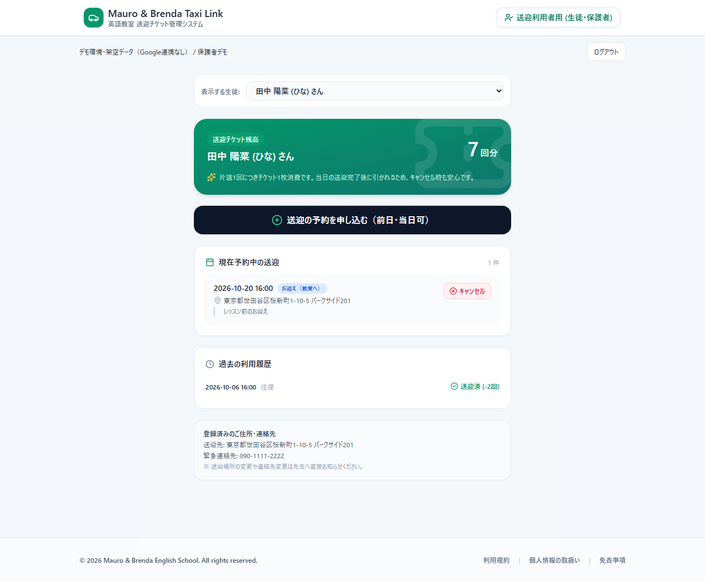

画像SHA-256: 336985bc1dfc709778e298d192e1916e191959c54a208014fb4474c623139478

次の対応: [TASK-20](05_TASKS.md#TASK-20)。

## AT-21 モバイル表示: PASS

[BF-08](01_BUSINESS_FLOWS.md#BF-08) / [UC-21](02_USE_CASES.md#UC-21) / [REQ-21](03_REQUIREMENTS.md#REQ-21) / [FS-21](04_FUNCTIONAL_SPEC.md#FS-21) / [TASK-21](05_TASKS.md#TASK-21) / [AT-21](06_ACCEPTANCE_TEST_SPEC.md#AT-21) / [CODE-21](07_TRACEABILITY_MATRIX.md#CODE-21) / [TEST-21](06_ACCEPTANCE_TEST_SPEC.md#TEST-21)

期待: 各画面でscrollWidthとinnerWidthが375px以下。保護者の予約・取消行も画面内に収まる。

実測: 仕様の期待結果を自動assertで確認。デモとローカル模擬API（AT-18/19）のみ。実Google連携は未実施。。

開始: 2026-10-19T17:00:41.466Z / 終了: 2026-10-19T17:00:43.955Z。

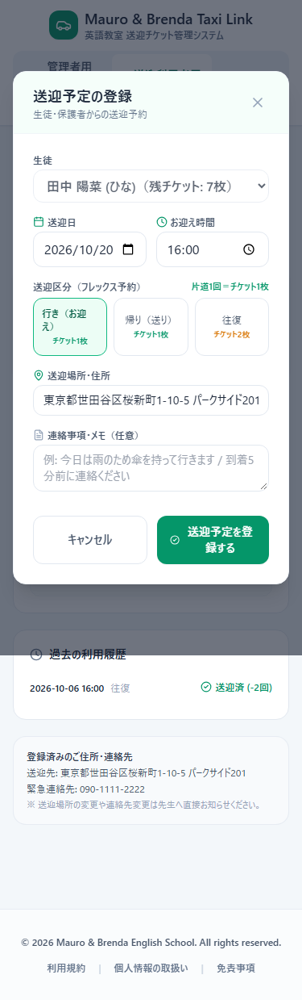

画像SHA-256: 9a2dca68a71fc601f792396de224f6cc42a30406766ede8db23b5f70b69eaceb

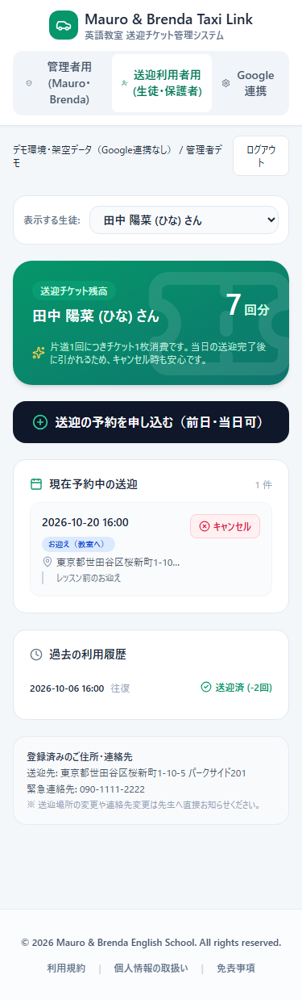

画像SHA-256: 1f1ac8d13befd982d7bbc6c7c7fb1f00ffd35d784d1fc9f810f2af4a2afbf83c

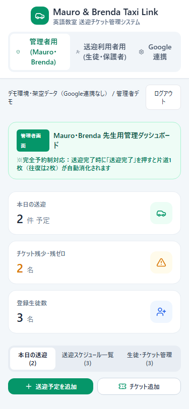

画像SHA-256: f71d0ed088934d38cfead6be5145377e39ac6d2cc1c9b22a2049ba925d11fa68

画像SHA-256: 828adb91e0c9d9a04c7dacaaead216264b55de91a2cd2c4a2b88c95021ffbbfe

次の対応: [TASK-21](05_TASKS.md#TASK-21)。

## AT-22 再読込後の永続化: PASS

[BF-07](01_BUSINESS_FLOWS.md#BF-07) / [UC-22](02_USE_CASES.md#UC-22) / [REQ-22](03_REQUIREMENTS.md#REQ-22) / [FS-22](04_FUNCTIONAL_SPEC.md#FS-22) / [TASK-22](05_TASKS.md#TASK-22) / [AT-22](06_ACCEPTANCE_TEST_SPEC.md#AT-22) / [CODE-22](07_TRACEABILITY_MATRIX.md#CODE-22) / [TEST-22](06_ACCEPTANCE_TEST_SPEC.md#TEST-22)

期待: 追加した生徒・予約のIDと値が維持される。

実測: 仕様の期待結果を自動assertで確認。デモとローカル模擬API（AT-18/19）のみ。実Google連携は未実施。。

開始: 2026-10-19T17:00:43.955Z / 終了: 2026-10-19T17:00:47.392Z。

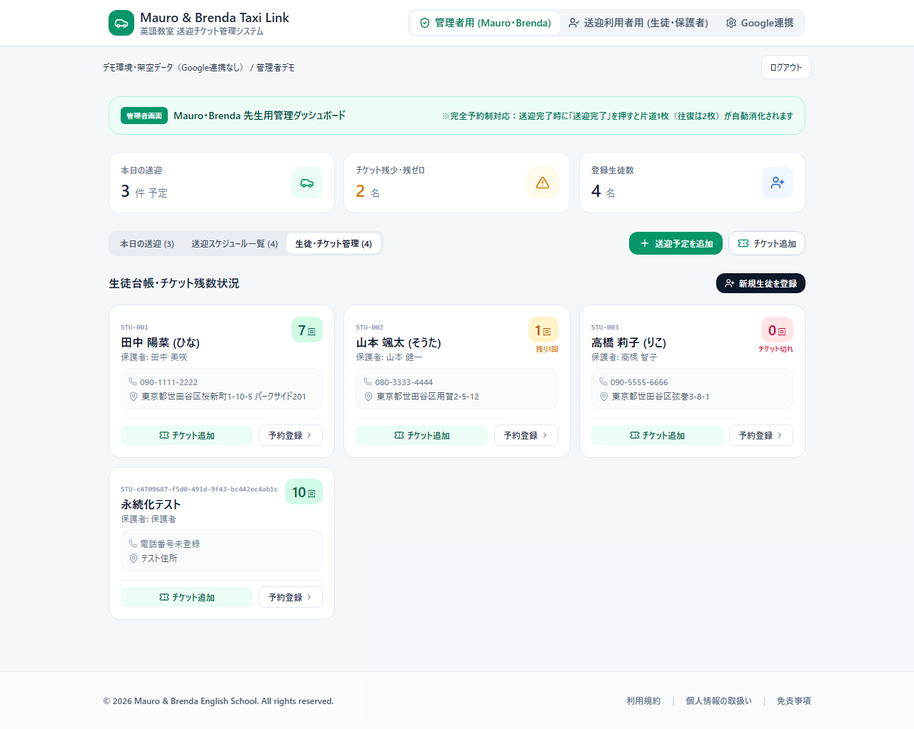

画像SHA-256: f7d758f393dcf7c4192f9a2cbebc5207495954a047e3c0dda3fb4b98e93c223e

次の対応: [TASK-22](05_TASKS.md#TASK-22)。

## AT-23 Google初期化・永続化: BLOCKED

[BF-01](01_BUSINESS_FLOWS.md#BF-01) / [UC-23](02_USE_CASES.md#UC-23) / [REQ-23](03_REQUIREMENTS.md#REQ-23) / [FS-23](04_FUNCTIONAL_SPEC.md#FS-23) / [TASK-23](05_TASKS.md#TASK-23) / [AT-23](06_ACCEPTANCE_TEST_SPEC.md#AT-23) / [CODE-23](07_TRACEABILITY_MATRIX.md#CODE-23) / [TEST-23](06_ACCEPTANCE_TEST_SPEC.md#TEST-23)

期待: 3シート生成・再実行で既存値不変・新規生徒1行。

実測: 専用Google環境・権限・受入担当または前段合格が未準備。実サービス操作は未実施。。

開始: 2026-10-19T17:00:47.392Z / 終了: 2026-10-19T17:00:47.392Z。

画面証跡なし（未実施）。

次の対応: [TASK-23](05_TASKS.md#TASK-23)。

## AT-24 実カレンダー予約同期: BLOCKED

[BF-04](01_BUSINESS_FLOWS.md#BF-04) / [UC-24](02_USE_CASES.md#UC-24) / [REQ-24](03_REQUIREMENTS.md#REQ-24) / [FS-24](04_FUNCTIONAL_SPEC.md#FS-24) / [TASK-24](05_TASKS.md#TASK-24) / [AT-24](06_ACCEPTANCE_TEST_SPEC.md#AT-24) / [CODE-24](07_TRACEABILITY_MATRIX.md#CODE-24) / [TEST-24](06_ACCEPTANCE_TEST_SPEC.md#TEST-24)

期待: 同一予約ID・日時・場所・イベントIDが一致。

実測: 専用Google環境・権限・受入担当または前段合格が未準備。実サービス操作は未実施。。

開始: 2026-10-19T17:00:47.392Z / 終了: 2026-10-19T17:00:47.392Z。

画面証跡なし（未実施）。

次の対応: [TASK-24](05_TASKS.md#TASK-24)。

## AT-25 実カレンダー取消同期: BLOCKED

[BF-05](01_BUSINESS_FLOWS.md#BF-05) / [UC-25](02_USE_CASES.md#UC-25) / [REQ-25](03_REQUIREMENTS.md#REQ-25) / [FS-25](04_FUNCTIONAL_SPEC.md#FS-25) / [TASK-25](05_TASKS.md#TASK-25) / [AT-25](06_ACCEPTANCE_TEST_SPEC.md#AT-25) / [CODE-25](07_TRACEABILITY_MATRIX.md#CODE-25) / [TEST-25](06_ACCEPTANCE_TEST_SPEC.md#TEST-25)

期待: cancelled・対象イベント削除・残高不変。

実測: 専用Google環境・権限・受入担当または前段合格が未準備。実サービス操作は未実施。。

開始: 2026-10-19T17:00:47.392Z / 終了: 2026-10-19T17:00:47.392Z。

画面証跡なし（未実施）。

次の対応: [TASK-25](05_TASKS.md#TASK-25)。

## AT-26 管理者2名・保護者の端末共有: BLOCKED

[BF-07](01_BUSINESS_FLOWS.md#BF-07) / [UC-26](02_USE_CASES.md#UC-26) / [REQ-26](03_REQUIREMENTS.md#REQ-26) / [FS-26](04_FUNCTIONAL_SPEC.md#FS-26) / [TASK-26](05_TASKS.md#TASK-26) / [AT-26](06_ACCEPTANCE_TEST_SPEC.md#AT-26) / [CODE-26](07_TRACEABILITY_MATRIX.md#CODE-26) / [TEST-26](06_ACCEPTANCE_TEST_SPEC.md#TEST-26)

期待: 同一予約・残高を確認し家庭の範囲を維持。

実測: 専用Google環境・権限・受入担当または前段合格が未準備。実サービス操作は未実施。。

開始: 2026-10-19T17:00:47.392Z / 終了: 2026-10-19T17:00:47.392Z。

画面証跡なし（未実施）。

次の対応: [TASK-26](05_TASKS.md#TASK-26)。

## AT-27 同時完了の排他制御: BLOCKED

[BF-06](01_BUSINESS_FLOWS.md#BF-06) / [UC-27](02_USE_CASES.md#UC-27) / [REQ-27](03_REQUIREMENTS.md#REQ-27) / [FS-27](04_FUNCTIONAL_SPEC.md#FS-27) / [TASK-27](05_TASKS.md#TASK-27) / [AT-27](06_ACCEPTANCE_TEST_SPEC.md#AT-27) / [CODE-27](07_TRACEABILITY_MATRIX.md#CODE-27) / [TEST-27](06_ACCEPTANCE_TEST_SPEC.md#TEST-27)

期待: 完了1件・片道1枚だけ消費、再試行でも不変。

実測: 専用Google環境・権限・受入担当または前段合格が未準備。実サービス操作は未実施。。

開始: 2026-10-19T17:00:47.392Z / 終了: 2026-10-19T17:00:47.392Z。

画面証跡なし（未実施）。

次の対応: [TASK-27](05_TASKS.md#TASK-27)。

## AT-28 バックアップから復旧: BLOCKED

[BF-08](01_BUSINESS_FLOWS.md#BF-08) / [UC-28](02_USE_CASES.md#UC-28) / [REQ-28](03_REQUIREMENTS.md#REQ-28) / [FS-28](04_FUNCTIONAL_SPEC.md#FS-28) / [TASK-28](05_TASKS.md#TASK-28) / [AT-28](06_ACCEPTANCE_TEST_SPEC.md#AT-28) / [CODE-28](07_TRACEABILITY_MATRIX.md#CODE-28) / [TEST-28](06_ACCEPTANCE_TEST_SPEC.md#TEST-28)

期待: 生徒・予約・購入履歴・カレンダーの整合を回復。

実測: 専用Google環境・権限・受入担当または前段合格が未準備。実サービス操作は未実施。。

開始: 2026-10-19T17:00:47.392Z / 終了: 2026-10-19T17:00:47.392Z。

画面証跡なし（未実施）。

次の対応: [TASK-28](05_TASKS.md#TASK-28)。

## AT-29 実機受入: BLOCKED

[BF-08](01_BUSINESS_FLOWS.md#BF-08) / [UC-29](02_USE_CASES.md#UC-29) / [REQ-29](03_REQUIREMENTS.md#REQ-29) / [FS-29](04_FUNCTIONAL_SPEC.md#FS-29) / [TASK-29](05_TASKS.md#TASK-29) / [AT-29](06_ACCEPTANCE_TEST_SPEC.md#AT-29) / [CODE-29](07_TRACEABILITY_MATRIX.md#CODE-29) / [TEST-29](06_ACCEPTANCE_TEST_SPEC.md#TEST-29)

期待: 入力・確認・操作が可能、受入担当の確認記録あり。

実測: 専用Google環境・権限・受入担当または前段合格が未準備。実サービス操作は未実施。。

開始: 2026-10-19T17:00:47.392Z / 終了: 2026-10-19T17:00:47.392Z。

画面証跡なし（未実施）。

次の対応: [TASK-29](05_TASKS.md#TASK-29)。

## AT-30 リリース後スモークテスト: BLOCKED

[BF-08](01_BUSINESS_FLOWS.md#BF-08) / [UC-30](02_USE_CASES.md#UC-30) / [REQ-30](03_REQUIREMENTS.md#REQ-30) / [FS-30](04_FUNCTIONAL_SPEC.md#FS-30) / [TASK-30](05_TASKS.md#TASK-30) / [AT-30](06_ACCEPTANCE_TEST_SPEC.md#AT-30) / [CODE-30](07_TRACEABILITY_MATRIX.md#CODE-30) / [TEST-30](06_ACCEPTANCE_TEST_SPEC.md#TEST-30)

期待: 対象コミットと公開版一致、重大不具合なし、戻し手順あり。

実測: 専用Google環境・権限・受入担当または前段合格が未準備。実サービス操作は未実施。。

開始: 2026-10-19T17:00:47.392Z / 終了: 2026-10-19T17:00:47.392Z。

画面証跡なし（未実施）。

次の対応: [TASK-30](05_TASKS.md#TASK-30)。

不合格の原因と対応: [不具合台帳・未実施一覧](10_DEFECTS_AND_VALIDATION.md)。

今回の画面証跡29枚。初回はPASS16/FAIL6/BLOCKED8、今回はPASS22/FAIL0/BLOCKED8。[初回の不変記録](runs/2026-10-19T14-45-09-864Z/results.json)。

[GAS回帰テスト](11_GAS_REGRESSION.md) は 38/38グループ合格。GASの実デプロイ後にAT-23〜30を別途確認する。

公開試験の最新状態: [テスト環境・公開版](13_MIGHTY_TEST_DEPLOYMENT.md) / [公開テスト仕様](14_HOSTED_TEST_SPEC.md) / [画面付き公開テスト結果](15_HOSTED_TEST_RESULTS.md)。公開画面23/23件合格・証跡40枚。ローカルATと実Google試験とは別集計。

